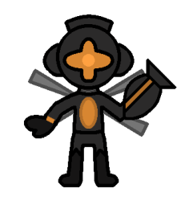
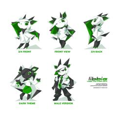
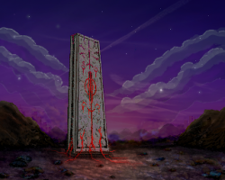
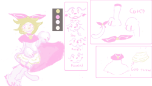
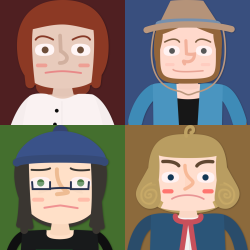

# OpenGameArt: concept art

**10 assets from [OpenGameArt](https://opengameart.org), dedicated to the public domain under [CC0](https://creativecommons.org/publicdomain/zero/1.0/).** Use them in any game, free or paid, and change them however you like; no credit is needed.

Concept art from OpenGameArt entries licensed CC0 (some also offer other licences; CC0 is the one that applies here). 127.9 MB in all.

This is a copy kept by [zuujis-cc0](https://github.com/zuujis-cc0) so game makers can take single files from GitHub. It is not made by or affiliated with OpenGameArt: the originals, often in more formats and higher resolutions, are on [opengameart.org](https://opengameart.org). If they help you, consider [supporting OpenGameArt](https://opengameart.org/content/faq).

Every file is listed in [MANIFEST.tsv](MANIFEST.tsv) with its size and SHA-256. More free assets: [the Zuujis collection](https://github.com/zuujis-cc0/free-game-assets#readme).

| | | | |
| :-: | :-: | :-: | :-: |
|  <b><a href="corrupted-metropolitan-angel">Corrupted metropolitan angel</a></b> by Cawfeecrow · <a href="https://opengameart.org/content/corrupted-metropolitan-angel">source</a> |  <b><a href="farm-life">Farm life</a></b> by Laurinetta · <a href="https://opengameart.org/content/farm-life">source</a> |  <b><a href="hollowtroid-concept-art">"Hollowtroid" Concept Art</a></b> by garylarsoncowtoolscomic · <a href="https://opengameart.org/content/hollowtroid-concept-art">source</a> |  <b><a href="libbie-the-cyber-oryx">Libbie the Cyber Oryx</a></b> by hardboileduser · <a href="https://opengameart.org/content/libbie-the-cyber-oryx">source</a> |
|  <b><a href="pillar-of-golgotha">Pillar of Golgotha</a></b> by knekko · <a href="https://opengameart.org/content/pillar-of-golgotha">source</a> |  <b><a href="riddle-the-cat">Riddle the cat</a></b> by Cawfeecrow · <a href="https://opengameart.org/content/riddle-the-cat">source</a> |  <b><a href="rifle-warrior-reference-portraits">Rifle Warrior Reference Portraits</a></b> by JumboSizedFish · <a href="https://opengameart.org/content/rifle-warrior-reference-portraits">source</a> |  <b><a href="space-bunny">Space Bunny</a></b> by 5hiroi · <a href="https://opengameart.org/content/space-bunny">source</a> |
|  <b><a href="toxic-barrels">Toxic Barrels</a></b> by BunnyX · <a href="https://opengameart.org/content/toxic-barrels">source</a> |  <b><a href="unamed-fantasy-creature">unamed fantasy creature</a></b> by Cawfeecrow · <a href="https://opengameart.org/content/unamed-fantasy-creature">source</a> |  |  |

---

Kept up to date by this repository's own [update workflow](.github/workflows/update.yml), with code and plan from [cc0-mirror](https://github.com/zuujis-cc0/cc0-mirror). Something wrong? [Open an issue there](https://github.com/zuujis-cc0/cc0-mirror/issues/new) or use the [private report form](https://games.zuujis.com/report).
