# OpenGameArt: concept art

**41 assets from [OpenGameArt](https://opengameart.org), dedicated to the public domain under [CC0](https://creativecommons.org/publicdomain/zero/1.0/).** Use them in any game, free or paid, and change them however you like; no credit is needed.

Concept art from OpenGameArt entries licensed CC0 (some also offer other licences; CC0 is the one that applies here). 343.6 MB in all.

This is a copy kept by [zuujis-cc0](https://github.com/zuujis-cc0) so game makers can take single files from GitHub. It is not made by or affiliated with OpenGameArt: the originals, often in more formats and higher resolutions, are on [opengameart.org](https://opengameart.org). If they help you, consider [supporting OpenGameArt](https://opengameart.org/content/faq).

Every file is listed in [MANIFEST.tsv](MANIFEST.tsv) with its size and SHA-256. More free assets: [the Zuujis collection](https://github.com/zuujis-cc0/free-game-assets#readme).

| | | | |
| :-: | :-: | :-: | :-: |
| <a href="1-bit-pixel-art-enemy-concepts">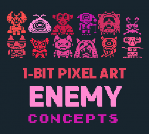</a> <b><a href="1-bit-pixel-art-enemy-concepts">1-Bit Pixel Art Enemy Concepts</a></b> by Fava Beans · <a href="https://opengameart.org/content/1-bit-pixel-art-enemy-concepts">source</a> | <a href="abstract-crystal-cave-background">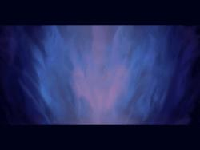</a> <b><a href="abstract-crystal-cave-background">Abstract crystal cave background</a></b> by pageofmoths · <a href="https://opengameart.org/content/abstract-crystal-cave-background">source</a> | <a href="angry-dwarf">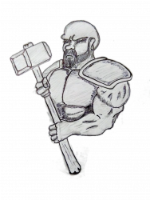</a> <b><a href="angry-dwarf">Angry Dwarf</a></b> by gustavoasilveira · <a href="https://opengameart.org/content/angry-dwarf">source</a> | <a href="ant-man">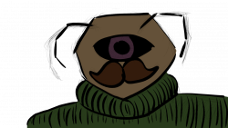</a> <b><a href="ant-man">Ant Man</a></b> by pjhanzlik · <a href="https://opengameart.org/content/ant-man">source</a> |
| <a href="breeze-witch">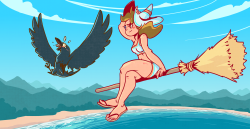</a> <b><a href="breeze-witch">breeze witch</a></b> by zonked · <a href="https://opengameart.org/content/breeze-witch">source</a> | <a href="character-design-nekomimi">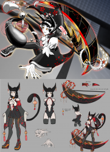</a> <b><a href="character-design-nekomimi">Character design nekomimi</a></b> by eysselia · <a href="https://opengameart.org/content/character-design-nekomimi">source</a> | <a href="cogland-concept-doodles">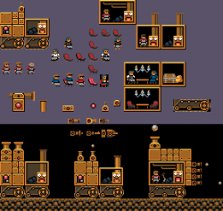</a> <b><a href="cogland-concept-doodles">Cogland Concept Doodles</a></b> by zwonky · <a href="https://opengameart.org/content/cogland-concept-doodles">source</a> | <a href="collectable-card-game-sun-burning-pizza-air-conditioner-delivery-guy-blue-old-man">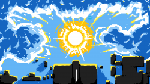</a> <b><a href="collectable-card-game-sun-burning-pizza-air-conditioner-delivery-guy-blue-old-man">Collectable card game: Sun, burning pizza, air conditioner, delivery guy, blue old man.</a></b> by Reduck · <a href="https://opengameart.org/content/collectable-card-game-sun-burning-pizza-air-conditioner-delivery-guy-blue-old-man">source</a> |
| <a href="color-palette-warm-grainy">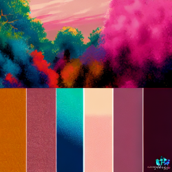</a> <b><a href="color-palette-warm-grainy">Color Palette Warm grainy</a></b> by ChiliTurtle · <a href="https://opengameart.org/content/color-palette-warm-grainy">source</a> | <a href="concept-art-for-the-scales">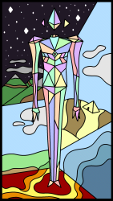</a> <b><a href="concept-art-for-the-scales">Concept Art For The Scales</a></b> by Trinity Paradox · <a href="https://opengameart.org/content/concept-art-for-the-scales">source</a> | <a href="continents-of-sustelas">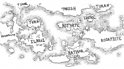</a> <b><a href="continents-of-sustelas">Continents of Sustelas</a></b> by Agecaf · <a href="https://opengameart.org/content/continents-of-sustelas">source</a> | <a href="corrupted-metropolitan-angel">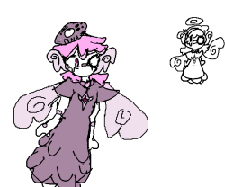</a> <b><a href="corrupted-metropolitan-angel">Corrupted metropolitan angel</a></b> by Cawfeecrow · <a href="https://opengameart.org/content/corrupted-metropolitan-angel">source</a> |
| <a href="demonz">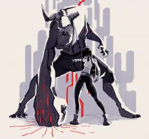</a> <b><a href="demonz">Demonz</a></b> by zonked · <a href="https://opengameart.org/content/demonz">source</a> | <a href="drill-game-ui-concept">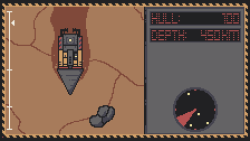</a> <b><a href="drill-game-ui-concept">Drill game UI concept</a></b> by GearShocky · <a href="https://opengameart.org/content/drill-game-ui-concept">source</a> | <a href="fantasy-concept-3">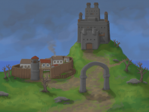</a> <b><a href="fantasy-concept-3">Fantasy Concept 3</a></b> by Drummyfish · <a href="https://opengameart.org/content/fantasy-concept-3">source</a> | <a href="fantasy-concept-4">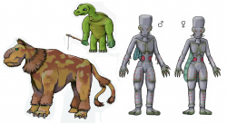</a> <b><a href="fantasy-concept-4">Fantasy Concept 4</a></b> by Drummyfish · <a href="https://opengameart.org/content/fantasy-concept-4">source</a> |
| <a href="fantasy-concepts">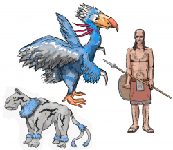</a> <b><a href="fantasy-concepts">Fantasy Concepts</a></b> by Drummyfish · <a href="https://opengameart.org/content/fantasy-concepts">source</a> | <a href="fantasy-concepts-2">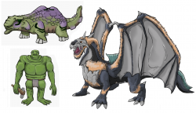</a> <b><a href="fantasy-concepts-2">Fantasy Concepts 2</a></b> by Drummyfish · <a href="https://opengameart.org/content/fantasy-concepts-2">source</a> | <a href="fantasy-rpg-background">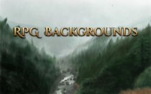</a> <b><a href="fantasy-rpg-background">Fantasy RPG Background</a></b> by AliHamieh · <a href="https://opengameart.org/content/fantasy-rpg-background">source</a> | <a href="farm-life">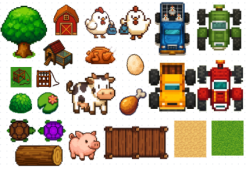</a> <b><a href="farm-life">Farm life</a></b> by Laurinetta · <a href="https://opengameart.org/content/farm-life">source</a> |
|  <b><a href="finned-luminescence-set-concept-art">Finned Luminescence | Set - Concept Art</a></b> by Winterkin_ · <a href="https://opengameart.org/content/finned-luminescence-set-concept-art">source</a> | <a href="fire-swords-concept">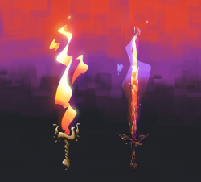</a> <b><a href="fire-swords-concept">Fire Swords Concept</a></b> by zonked · <a href="https://opengameart.org/content/fire-swords-concept">source</a> | <a href="fruitsvegetables">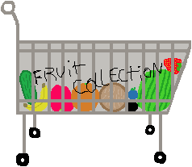</a> <b><a href="fruitsvegetables">Fruits/Vegetables</a></b> by Construct.Mily · <a href="https://opengameart.org/content/fruitsvegetables">source</a> | <a href="ghillie-gal">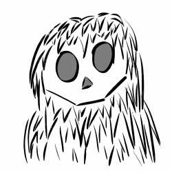</a> <b><a href="ghillie-gal">Ghillie Gal</a></b> by pjhanzlik · <a href="https://opengameart.org/content/ghillie-gal">source</a> |
|  <b><a href="hollowtroid-concept-art">"Hollowtroid" Concept Art</a></b> by garylarsoncowtoolscomic · <a href="https://opengameart.org/content/hollowtroid-concept-art">source</a> | <a href="kitty-rider">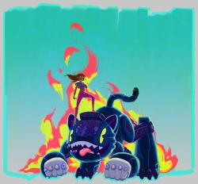</a> <b><a href="kitty-rider">kitty-rider</a></b> by zonked · <a href="https://opengameart.org/content/kitty-rider">source</a> |  <b><a href="libbie-the-cyber-oryx">Libbie the Cyber Oryx</a></b> by hardboileduser · <a href="https://opengameart.org/content/libbie-the-cyber-oryx">source</a> | <a href="map-of-the-pandemos-empire-world-of-sustelas">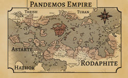</a> <b><a href="map-of-the-pandemos-empire-world-of-sustelas">Map of the Pandemos Empire (World of Sustelas)</a></b> by Agecaf · <a href="https://opengameart.org/content/map-of-the-pandemos-empire-world-of-sustelas">source</a> |
| <a href="monolith-with-backdrop">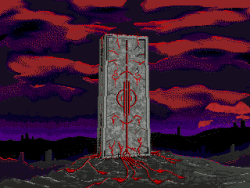</a> <b><a href="monolith-with-backdrop">Monolith with backdrop</a></b> by knekko · <a href="https://opengameart.org/content/monolith-with-backdrop">source</a> |  <b><a href="pillar-of-golgotha">Pillar of Golgotha</a></b> by knekko · <a href="https://opengameart.org/content/pillar-of-golgotha">source</a> | <a href="possessed">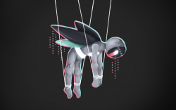</a> <b><a href="possessed">Possessed</a></b> by flowerorchid · <a href="https://opengameart.org/content/possessed">source</a> | <a href="post-apocalyptic-poster">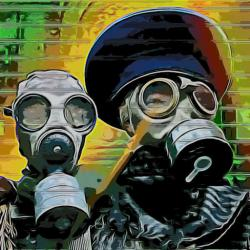</a> <b><a href="post-apocalyptic-poster">Post-apocalyptic Poster</a></b> by gonzalofdz · <a href="https://opengameart.org/content/post-apocalyptic-poster">source</a> |
|  <b><a href="riddle-the-cat">Riddle the cat</a></b> by Cawfeecrow · <a href="https://opengameart.org/content/riddle-the-cat">source</a> |  <b><a href="rifle-warrior-reference-portraits">Rifle Warrior Reference Portraits</a></b> by JumboSizedFish · <a href="https://opengameart.org/content/rifle-warrior-reference-portraits">source</a> | <a href="secretkeeper-0">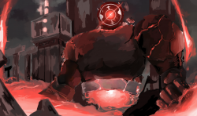</a> <b><a href="secretkeeper-0">Secretkeeper</a></b> by daveomancer · <a href="https://opengameart.org/content/secretkeeper-0">source</a> | <a href="space-bunny">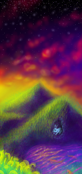</a> <b><a href="space-bunny">Space Bunny</a></b> by 5hiroi · <a href="https://opengameart.org/content/space-bunny">source</a> |
| <a href="surts-cc0-scraps-creatures-characters-terrain-ideas">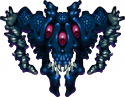</a> <b><a href="surts-cc0-scraps-creatures-characters-terrain-ideas">Surt's CC0 Scraps - Creatures, Characters, & Terrain ideas</a></b> by MedicineStorm · <a href="https://opengameart.org/content/surts-cc0-scraps-creatures-characters-terrain-ideas">source</a> | <a href="surts-cc0-scraps-monochrome-doodles">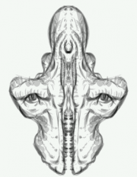</a> <b><a href="surts-cc0-scraps-monochrome-doodles">Surt's CC0 Scraps - Monochrome doodles</a></b> by MedicineStorm · <a href="https://opengameart.org/content/surts-cc0-scraps-monochrome-doodles">source</a> | <a href="the-lunar-moth-set-concept-art">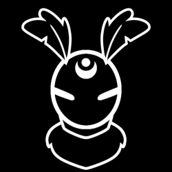</a> <b><a href="the-lunar-moth-set-concept-art">The Lunar Moth | Set - Concept Art</a></b> by Winterkin_ · <a href="https://opengameart.org/content/the-lunar-moth-set-concept-art">source</a> | <a href="toxic-barrels">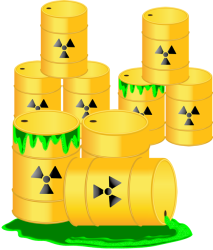</a> <b><a href="toxic-barrels">Toxic Barrels</a></b> by BunnyX · <a href="https://opengameart.org/content/toxic-barrels">source</a> |
| <a href="unamed-fantasy-creature">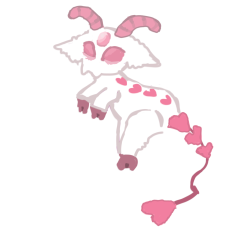</a> <b><a href="unamed-fantasy-creature">unamed fantasy creature</a></b> by Cawfeecrow · <a href="https://opengameart.org/content/unamed-fantasy-creature">source</a> |  |  |  |

---

Kept up to date by this repository's own [update workflow](.github/workflows/update.yml), with code and plan from [cc0-mirror](https://github.com/zuujis-cc0/cc0-mirror). Something wrong? [Open an issue there](https://github.com/zuujis-cc0/cc0-mirror/issues/new) or use the [private report form](https://games.zuujis.com/report).
